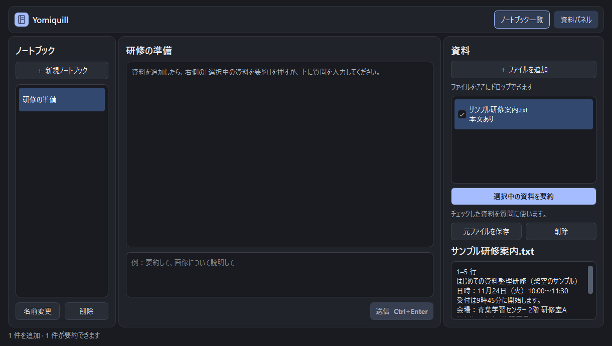
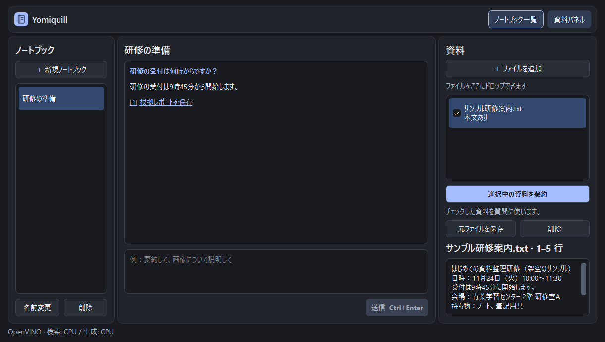

# Yomiquill（ヨミクイル）

**手元の資料を読み、回答の根拠を原本までたどれる Windows アプリです。**

PDF・Office 文書・画像などを追加すると、日本語で質問したり要約したりできます。モデルの取得後は OCR・検索・回答生成を PC 上で実行できます。

## はじめる

**Windows x64、64 ビット版 Python 3.12、モデル用の空き容量約 5.8 GB** が必要です。初回は依存ライブラリとモデルの取得にインターネット接続を使います。

1. [64 ビット版 Python 3.12](https://www.python.org/downloads/windows/) を用意します。インストール時は Python Launcher（`py`）も有効にします。
2. 次のコマンドでクローンするか、[ソース ZIP](https://github.com/kazukiminemura/Yomiquill/archive/refs/heads/main.zip) を展開します。
3. フォルダー内の **`Start-Yomiquill.cmd`** をダブルクリックします。初回は仮想環境・ライブラリ・モデルを準備してからアプリを開きます。

```powershell
git clone https://github.com/kazukiminemura/Yomiquill.git
cd Yomiquill
.\Start-Yomiquill.cmd
```

2 回目以降も同じファイルで起動します。準備済みのライブラリやモデルを再利用します。初回の準備が中断した場合は、同じファイルをもう一度実行してください。起動せず準備だけ行うには `.\Start-Yomiquill.cmd --setup-only` を使えます。

## 資料追加から根拠レポート保存まで

### 1. 資料を追加する

左側でノートブックを作ります。ファイルをウィンドウへドロップするか、右側の「ファイルを追加」から選びます。追加すると資料一覧に名前が表示され、選んだ資料の本文をプレビューできます。



### 2. 質問して引用を開く

質問に使う資料にチェックを入れ、中央の入力欄から質問を送信します。回答の下にある引用番号（例では `[1]`）を押すと、参照した箇所が右側に表示されます。



取り込み・要約・回答の進捗は中央の会話欄に表示されます。回答や要約の途中でも資料を追加でき、追加分は次の質問から使えます。

### 3. 根拠レポートを保存する

回答の引用番号の横にある「根拠レポートを保存」を押し、HTML の保存先を選びます。レポートには質問・回答・引用位置・抽出本文・原本の SHA-256 が入ります。保存した HTML はブラウザーで開けます。

原本を照合するには、次のコマンドで調べた SHA-256 とレポートの値を比べます。

```powershell
Get-FileHash -Algorithm SHA256 -LiteralPath 'サンプル研修案内.txt'
```

ハッシュが一致すれば、手元のファイルは保存時の原本と同じ内容です。回答が原文に沿っているかは、レポートが示す箇所を読んで確認できます。

## 対応する資料

| 資料 | できること |
| --- | --- |
| テキスト PDF、Word（.docx）、Excel（.xlsx）、PowerPoint（.pptx）、テキスト、CSV | 本文のプレビュー、質問、要約 |
| スキャン PDF | Windows の OCR で文字を読み取り、本文をプレビュー、質問、要約 |
| PNG・JPEG・WebP などの画像 | 画像モデルで見た目や読める文字を説明 |
| 動画など解析対象外のファイル | 添付として保管 |

要約するときは、資料を選んで「選択中の資料を要約」を押すか、チャットに「要約して」と入力します。原本は「元ファイルを保存」から取り出せます。スキャン PDF の読み取り精度は画像の鮮明さと、Windows にインストールされている OCR 言語に左右されます。

## データの保存先と実行デバイス

ノートブック、原本、モデルはローカルに保存されます。標準の保存先は、旧版との互換性のため `%LOCALAPPDATA%\NotebookForAIPC` です。Microsoft Store 版 Python が別の場所に作った既存のノートブックも検出できます。

既定では対応する Intel GPU を優先し、使用できない場合は CPU で実行します。起動前に `$env:NOTEBOOK_DEVICE = 'CPU'` とすると CPU に固定できます。 `'NPU'` を指定した場合、資料検索用の処理で Intel NPU を優先します。回答・要約の生成には GPU または CPU を使います。

## 開発とライセンス

```powershell
ruff check .
.\.venv\Scripts\python.exe -m unittest -v
.\.venv\Scripts\python.exe make_source_release.py
```

| 機能 | 操作 | 合格条件 |
| --- | --- | --- |
| 資料追加と PDF 要約 | 本文を選択できる PDF を追加してチェックを入れる。空の入力欄で Tab を押し、例文を Ctrl+Enter で送信する | 要約が表示され、参照リンクから指定 PDF のページ番号と原文が開く |
| 資料への質問 | 質問対象の資料をチェックして送信する | 資料に基づく回答が表示され、参照リンクから該当箇所が開く |
| 根拠レポートの保存 | 引用付きの回答から「根拠レポートを保存」を選び、保存した HTML を開く | 質問・回答・引用位置・原文が表示され、SHA-256 が原本と一致する |
| pip の自動復旧 | pip を持たない仮想環境を使うランチャーの回帰テストを実行する | pip が自動で導入され、依存関係の準備が完了する |

公開用の `dist\Yomiquill-source.zip` にはアプリのソースと文書だけが入ります。ローカルで Windows 実行ファイルを検証する場合は、同じ仮想環境に `pyinstaller==6.22.3` を入れ、`.\build.ps1 -LocalOnly` を実行します。

ソースは [MIT ライセンス](LICENSE)です。依存ライブラリとモデルの条件は [第三者ライセンス](THIRD_PARTY_NOTICES.md)を参照してください。
